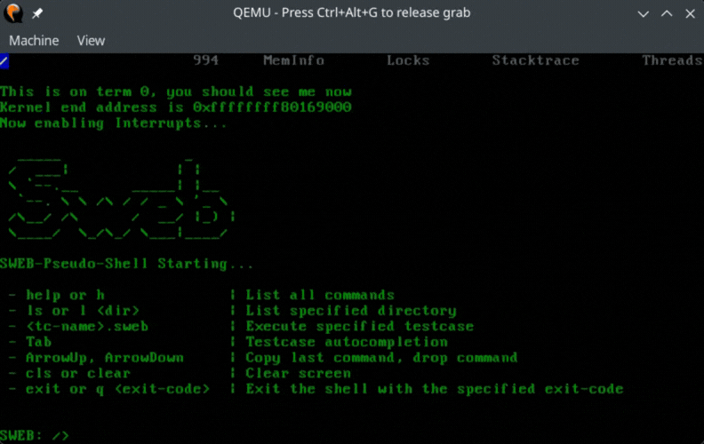

# ps2-mouse-driver-sweb
A low-level interrupt-driven x86 64-bit PS/2 mouse driver implemented in C++ for **SWEB**, developed at TU Graz.

# demo


# adding the mouse driver to SWEB:
## Step 1) add the files directly to the folder structure
add 'arch/common/include/MouseManager.h'
add 'arch/x86/common/source/MouseManager.cpp'

## Step 2) Set up IRQ12 and Interrupt handlers
### add the enable and disable mouse interrupt method definitions
by add these public methods to class ArchInterrupts in file 'arch/common/include/ArchInterrupts.h'
```
    static void enableMouse();
    static void disableMouse();
```

### add the enable and disable mouse interrupt method bodies  
add these methods to 'arch/x86/64/source/ArchInterrupts.cpp'
```
    void ArchInterrupts::enableMouse()
    {
        //interrupt 12 is the PS2 mouse interrupt on x86
        //note: we have also enabled this interrupt in the arch_interrupts.S file and add it
        //to the IDT handler table
        enableIRQ(12);
    }
    void ArchInterrupts::disableMouse()
    {
        disableIRQ(12);
    }
```

## add the relevant include and define the IRQ handler
add these lines to 'arch/x86/64/source/InterruptUtils.cpp'

```
    #include "MouseManager.h"
```
[...]
```
    extern "C" void arch_irqHandler_12();
    extern "C" void irqHandler_12()
    {
        debug(MOUSE_DRIVER, "in irq handler 12 now...\n");
        //kprintfd( "IRQ 12 called\n" );
        ++outstanding_EOIs;
        MouseManager::instance()->serviceIRQ( );
        ArchInterrupts::EndOfInterrupt(12);
    }
```

## add the interrupt in the assembly-level interrupt and exception entry layer
change this line in 'arch/x86/64/source/arch_interrupts.S' from 
```
    .irp num,0,1,3,4,6,9,11,14,15,65
```
to 
```
    .irp num,0,1,3,4,6,9,11,12,14,15,65
```

## add the interrupt to the added to the IDT handler table
add this line to the struct InterruptHandlers InterruptUtils::handlers[] in 'arch/x86/common/include/ErrorHandlers.h '
while making sure the IDT table stays correctly formatted
```
    IRQHANDLER(12)
```

## Step 3) add functions to get and set terminal characters
### change the visibility of Terminal class methods and add getCharacter method
make these method definitions public in 'common/include/console/Terminal.h'
```
    uint32 setCharacter(uint32 row, uint32 column, uint8 character);
    uint32 getNumRows() const;
    uint32 getNumColumns() const;
```
also add a new method definition
```
    uint8 getCharacter(uint32 row, uint32 column);
```

## add the method body to get the current terminal character
add these lines to 'common/source/console/Terminal.cpp'
```
uint8 Terminal::getCharacter(uint32 row, uint32 column)
    {
    return characters_[column + row * num_columns_];
    }
```

## Step 4) instantiate the MouseManager and enable mouse interrupts
### add the relevant include and instantiate the mouse manager in the main function
add these lines to 'common/source/kernel/main.cpp'
```
    #include "MouseManager.h"
```
[...]
```
    //after enabling keyboard, but before adding kernel threads
    MouseManager::instance();
    ArchInterrupts::enableMouse();
```

## OPTIONAL: define debug color for mouse driver warnings
### define a debug color for the mouse driver (optional)
optionally, add these lines to common/include/console/debug.h
```
    const size_t MOUSE_DRIVER       = Ansi_Yellow;// | OUTPUT_ENABLED;
```
